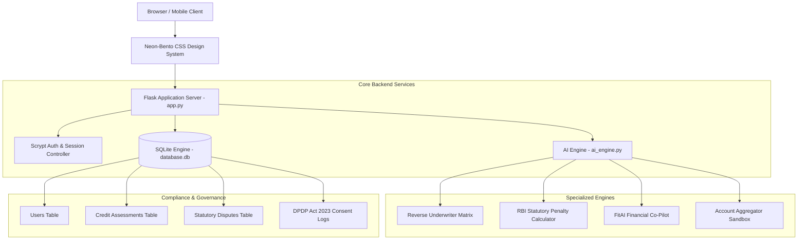

# CreditFit 360™ — Comprehensive Master Product & Client Presentation Report

> **Document Type:** Institutional Product Dossier & Client Pitch Deck Guide  
> **Entity:** CreditFit 360 Financial Technologies  
> **Target Audience:** Corporate Clients, Fintech Partners, Venture Investors, Institutional Evaluators  
> **Platform Version:** 2.5 (Neon-Bento Enterprise Edition)  
> **Status:** Production-Ready MVP  

---

## Executive Summary

**CreditFit 360** is India’s first **Borrower-Centric Financial Health, Reverse Underwriting, and Regulatory Defense Operating System**.

While legacy fintech platforms (CRED, Paisabazaar, BankBazaar) operate primarily as **loan distribution brokers**—earning commissions from banks by pushing high-interest credit—CreditFit 360 operates exclusively on behalf of the **borrower**. It transforms credit from an opaque, reactive 3-digit score into an actionable, reverse-engineered roadmap with regulatory enforcement rights under the Reserve Bank of India (RBI).

```
                      LEGACY FINTECH vs. CREDITFIT 360
┌───────────────────────────────┬───────────────────────────────────────────────┐
│ Traditional Portals (Brokers) │ CreditFit 360 (Borrower Defense Suite)        │
├───────────────────────────────┼───────────────────────────────────────────────┤
│ • Aligned with lenders        │ • Aligned 100% with the borrower              │
│ • Lead-gen loan marketplace   │ • Reverse-underwrites bank rejection risks    │
│ • "Hard Inquiries" hurt score │ • Zero-inquiry simulation before applying     │
│ • Silent on bank errors       │ • Enforces RBI ₹100/day statutory penalty     │
│ • Ignores MSME cash flows     │ • Holistic multi-factor SME scoring engine    │
│ • Closed session storage      │ • DPDP Act 2023 compliant data governance     │
└───────────────────────────────┴───────────────────────────────────────────────┘
```

---

## 1. The Core Problem Statement & Market Opportunity

### The 4 Major Credit Inefficiencies in India:
1. **The Credit Opacity Problem:** Over 68% of loan applicants in India do not know why their loans are rejected. Banks do not reject based on credit score alone; they evaluate **FOIR (Fixed Obligation to Income Ratio)**, debt service coverage, credit mix, and inquiry velocity.
2. **The "Hard Inquiry" Downward Spiral:** When a borrower faces rejection, they apply to 3 or 4 other banks in panic. Each application logs a hard search on CIBIL/Experian, dropping their score by 15–30 points and locking them out of prime interest rates.
3. **The Unenforced ₹100/Day RBI Statutory Penalty:** Under RBI Master Circular **CEPC/2023-24**, all Credit Information Companies (CIBIL, Experian, CRIF, Equifax) and lenders must resolve credit grievance errors within **30 days** or pay the customer a mandatory penalty of **₹100 per day of delay**. Over 99% of Indian citizens are unaware of this statutory right.
4. **The MSME Financing Gap:** Over 63 million MSMEs face a $300B credit shortfall because traditional underwriting relies on vintage retail bureau records rather than real operating cash flow, GST regularities, and liquidity buffers.

---

## 2. Platform Architecture & Technology Stack



### Technical Specifications:
- **Application Server:** Python 3.10+, Flask 3.1+ (RESTful JSON APIs & Jinja2 server-rendered views).
- **Persistence Layer:** Zero-dependency, lightweight SQLite database ([`database.db`](file:///c:/Users/smita/OneDrive/Desktop/Creditfit360/database.db)) managed through a dedicated abstraction module ([`db.py`](file:///c:/Users/smita/OneDrive/Desktop/Creditfit360/db.py)).
- **Security & Password Protection:** `scrypt` hashing via `werkzeug.security` with salt generation.
- **Frontend Architecture:** Vanilla CSS Design System with high-contrast glassmorphism, responsive CSS grid, Google Plus Jakarta Sans & JetBrains Mono typography, and `@media print` A4 document styles.
- **Dedicated Server Runner:** [`server.py`](file:///c:/Users/smita/OneDrive/Desktop/Creditfit360/server.py) with automatic port-conflict resolution, LAN IP discovery for mobile testing, and automatic browser launch.

---

## 3. Exhaustive Walkthrough of All 15 Platform Modules

### 1. Authentication & Enterprise Portal (`/`, [`login.html`](file:///c:/Users/smita/OneDrive/Desktop/Creditfit360/templates/login.html))
- **Interactive Tabbed Auth:** Seamless toggle between **Sign In** and **Create Account**.
- **⚡ 1-Click Demo Login:** Preloaded with verified credentials (`demo@creditfit360.com` / `Demo@123`) for zero-friction demonstrations.
- **Guest Mode:** Allows evaluators and prospective customers to test simulators without forcing registration.

### 2. Financial Intelligence Command Center (`/dashboard`, [`dashboard.html`](file:///c:/Users/smita/OneDrive/Desktop/Creditfit360/templates/dashboard.html))
- **Live Health Gauge:** Visual 0–100 CreditFit health index categorized into Prime, Near-Prime, or Subprime.
- **Personalized Header:** Displays dynamic greeting with the logged-in user's name.
- **Proactive Alerts:** Surfaces immediate financial alerts (e.g. FOIR breach, high utilization warnings).
- **Direct Export Button:** One-click launch to the institutional loan dossier.

### 3. Personal CreditFit Engine (`/personal-credit`, [`personal_credit.html`](file:///c:/Users/smita/OneDrive/Desktop/Creditfit360/templates/personal_credit.html))
- **4-Step Underwriting Wizard:** 
  1. *Basic Information:* Age, employment status, gross monthly income.
  2. *Financial Position:* Household expenses, existing EMIs, monthly savings.
  3. *Credit Information:* Score, revolving limits, current outstanding, missed payments.
  4. *Emergency Reserves:* Liquid savings, essential expenses, and runway months.
- **⚡ India Stack Account Aggregator (AA) Auto-Fill:** Connects to simulated RBI-regulated FIPs (HDFC, SBI, ICICI) via OTP `123456`, instantly populating verified bank figures without manual data entry.
- **Automatic Persistence:** Saves calculations into the user’s database history upon submission.

### 4. SME CreditScore Engine (`/sme-credit-score`, [`sme_credit_score.html`](file:///c:/Users/smita/OneDrive/Desktop/Creditfit360/templates/sme_credit_score.html))
- Specifically tailored for small enterprises and sole proprietorships lacking audited balance sheets.
- Multi-dimensional scoring evaluating:
  - Business operational vintage (stability index).
  - Profit margin consistency.
  - Vendor & supplier invoice payment track record.
  - Working capital cash reserve buffer.

### 5. Institutional Loan Readiness Dossier (`/dossier`, [`dossier.html`](file:///c:/Users/smita/OneDrive/Desktop/Creditfit360/templates/dossier.html))
- **Executive A4 Print Layout:** Formatted with formal institutional styling suitable for presentation to bank loan managers.
- **Verification ID:** Unique cryptographic reference (e.g. `CF360-IND-202610-8921`).
- **Max Sanctionable Loan Engine:** Calculates the maximum sanctionable loan under a standard 50% FOIR ceiling over 60 months at prime rates.
- **Pre-Approval Odds Matrix:** Displays tailored probability scores for SBI, HDFC Bank, ICICI Bank, and Kotak Mahindra.
- **1-Click PDF & JSON:** Uses native browser print formatting to export clean PDFs without web UI headers or buttons.

### 6. Reverse Underwriting Suite (`/defense-suite`, [`defense_suite.html`](file:///c:/Users/smita/OneDrive/Desktop/Creditfit360/templates/defense_suite.html))
- Simulates bank credit committee decisions *before* an application is submitted.
- Tests requested loan amount, proposed tenure, and interest rates against the borrower's debt capacity.
- Highlights exact failure points (e.g., "FOIR exceeds 50% by 4.2%") and provides restorative recommendations.

### 7. RBI Statutory Penalty Enforcer (`/defense-suite` tab 2)
- Implements RBI Master Direction CEPC/2023-24.
- Calculates statutory compensation: **Days Delayed beyond 30 days × ₹100/day**.
- Automatically drafts a formal legal grievance notice referencing Section 21 of the Credit Information Companies (Regulation) Act, 2005.
- Automatically records served dispute notices into `database.db`.

### 8. FitAI Financial Co-Pilot (`/assistant`, [`assistant.html`](file:///c:/Users/smita/OneDrive/Desktop/Creditfit360/templates/assistant.html))
- Built-in natural language financial assistant powered by [`ai_engine.py`](file:///c:/Users/smita/OneDrive/Desktop/Creditfit360/ai_engine.py).
- Synchronizes with active session metrics (FOIR, credit score, monthly balance) to deliver context-aware advice.
- Includes quick-action prompt chips (e.g. "How do I cut FOIR below 30%?", "Explain RBI compensation circular").

### 9. MoneyMap Cash Flow Visualizer (`/moneymap`, [`moneymap.html`](file:///c:/Users/smita/OneDrive/Desktop/Creditfit360/templates/moneymap.html))
- Interactive income-to-expenditure flow allocation tool.
- Visualizes fixed obligations, living costs, discretionary spending, and liquid surplus.

### 10. Financial Decision Lab (`/decision-lab`, [`decision_lab.html`](file:///c:/Users/smita/OneDrive/Desktop/Creditfit360/templates/decision_lab.html))
- A/B financial scenario testing engine.
- Compares strategic trade-offs (e.g., *Prepaying ₹5,00,000 against a Home Loan vs. Investing ₹5,00,000 in an Equity Index Fund over 15 years*).

### 11. Wealth Path Milestone Planner (`/wealth-path`, [`wealth_path.html`](file:///c:/Users/smita/OneDrive/Desktop/Creditfit360/templates/wealth_path.html))
- Goal-based milestone planner with compound growth and inflation adjustments.
- Guides users on accumulating down payments for home or business asset purchases.

### 12. What-If FinTwin Simulator (`/what-if-simulator`, [`what_if_simulator.html`](file:///c:/Users/smita/OneDrive/Desktop/Creditfit360/templates/what_if_simulator.html))
- Digital twin simulation allowing users to slide loan payoffs, credit line closures, or new credit card balances to observe the simulated impact on their score over a 12-month horizon.

### 13. DPDP Act 2023 Privacy & Governance Center (`/privacy-consent-center`, [`privacy_center.html`](file:///c:/Users/smita/OneDrive/Desktop/Creditfit360/templates/privacy_center.html))
- **Section 6 Consent Audit Trail:** Immutable table of all data access events, purpose codes, timestamps, and IP origins.
- **Section 12 Right to Data Portability:** Download full user history as a structured JSON dossier via `/api/export-user-data`.
- **Section 12 Right to Erasure:** Permanent, irreversible purge of all records from `database.db` via `/api/erase-user-data`.

### 14. Settings & Account Profile (`/settings`, [`settings.html`](file:///c:/Users/smita/OneDrive/Desktop/Creditfit360/templates/settings.html))
- Account management, notification preferences, security controls, and links to the DPDP Privacy Center.

### 15. Institutional About & Regulatory Disclaimer (`/about`, `/disclaimer`)
- Transparent declarations clarifying that CreditFit 360 operates as an educational and analytical financial technology platform.

---

## 4. The 7-Minute Live Client Presentation Script

When demonstrating CreditFit 360 to a client, investor, or jury, follow this structured walkthrough:

```
┌─────────────────────────────────────────────────────────────────────────────┐
│                       7-MINUTE CLIENT PRESENTATION FLOW                     │
├─────────┬──────────────────────┬────────────────────────────────────────────┤
│ Time    │ Stage                │ Key Focus & Demonstration                  │
├─────────┼──────────────────────┼────────────────────────────────────────────┤
│ Min 1   │ The Hook & Problem   │ The borrower problem: credit opacity & CIBIL│
│ Min 2   │ Portal & Dashboard   │ Click '1-Click Demo Login' -> Live Overview│
│ Min 3   │ Account Aggregator   │ Click 'Connect Bank via AA' -> Instant OTP │
│ Min 4   │ Reverse Underwriting │ Show bank approval odds before hard inquiry│
│ Min 5   │ RBI Penalty Enforcer │ Calculate ₹100/day statutory legal claim   │
│ Min 6   │ Official Dossier     │ Export print-ready A4 executive PDF        │
│ Min 7   │ DPDP & Business Model│ Show Section 12 data purge & revenue paths │
└─────────┴──────────────────────┴────────────────────────────────────────────┘
```

### Minute 1: The Hook (Opening Statement)
> *"Good morning / afternoon. In India today, over 150 million consumers and 60 million MSMEs interact with credit. Yet, when they apply for a loan, they enter a complete black box. Platforms like CRED or Paisabazaar are essentially loan distribution agents—they get paid when you borrow more. Nobody is in the borrower's corner. We built CreditFit 360 to be the first **Borrower Defense and Reverse Underwriting Suite** in India."*

### Minute 2: Sign-In & Dashboard
> *"Let’s open the platform. On the landing page, notice we support full user authentication. For this demonstration, I'll use our **1-Click Demo Login**.*
> *(Click '⚡ 1-Click Demo Login')*
> *We arrive at the Executive Dashboard. Rather than just showing a vanity 3-digit score, CreditFit 360 surfaces FOIR limits, emergency runway months, and predictive risk flags."*

### Minute 3: India Stack Account Aggregator (AA) Auto-Fill
> *(Navigate to 'Personal CreditFit')*
> *"Normally, filling a 20-field financial form leads to drop-offs. Watch this:*
> *(Click '🏦 Connect Bank via AA')*
> *We leverage India's RBI Account Aggregator framework. The user chooses their bank, enters their mobile number, and confirms the simulated OTP `123456`. Instantly, our system securely pulls verified salary credits, existing EMIs, and liquid reserves, auto-filling all four stages of the underwriting engine."*

### Minute 4: Reverse Underwriting
> *(Navigate to 'Defense & Approval' -> 'Reverse Underwriting')*
> *"Here is where CreditFit 360 protects the consumer. Instead of submitting a loan application and risking a score-damaging hard inquiry, our Reverse Underwriter stress-tests the applicant's profile against Tier-1 bank credit committee policies. If the FOIR is too high, it advises them on the exact amount of debt to pay off first."*

### Minute 5: RBI Statutory Compensation Enforcement
> *(Click the 'Statutory Defense & RBI Notice' tab)*
> *"This is our standout regulatory defense feature. Under the RBI CEPC 2023 circular, banks must resolve credit report disputes within 30 days. If they fail, they owe the borrower ₹100 per day. Here, the borrower enters their dispute date, and CreditFit 360 computes the statutory penalty and produces a ready-to-dispatch legal notice under Section 21 of the CIC Act."*

### Minute 6: Exporting the Loan Readiness Dossier (PDF)
> *(Click '📑 Export Dossier (PDF)')*
> *"When a borrower is ready to apply, they don't walk into a bank empty-handed. CreditFit 360 generates this **Institutional Loan Readiness Dossier**, complete with verification ID, FOIR stress metrics, and bank approval probabilities. With a single click, it prints into a clean, professional A4 PDF."*

### Minute 7: DPDP Compliance & Closing
> *(Click '🛡️ DPDP Privacy Center')*
> *"Finally, we take compliance seriously. Under India's Digital Personal Data Protection Act 2023, users can view their immutable consent audit trail, download their full data package, or execute the **Right to Erasure** to permanently purge their database records. CreditFit 360 is not just an academic prototype; it is an enterprise-grade fintech platform ready for market deployment. Thank you."*

---

## 5. Monetization & Business Models

| Stream | Target Segment | Pricing / Structure | Projected Potential |
| :--- | :--- | :--- | :--- |
| **B2C Premium Defense** | Retail Borrowers | ₹399/year or ₹49/month | Unlimited What-If simulations, auto-dispute notice generation, RBI delay compensation tracking. |
| **B2B SaaS for CAs & DSAs** | Loan Agents & Accounting Firms | ₹1,499/month per license | Client readiness assessment dossiers to prevent loan rejections and qualify leads before bank submission. |
| **Qualified Referral Routing** | Tier-2 & Tier-3 NBFCs | 1.0% – 1.8% loan sanction payout | Routing pre-vetted borrowers whose debt ratios match exact lender underwriting criteria. |

---

## 6. Objection Handling (Q&A Preparation)

#### Q1: "How does CreditFit 360 differ from CRED or OneScore?"
> **Answer:** *"CRED and OneScore are distribution brokers funded by lender affiliate fees; their commercial incentive is to get you to take another credit card or personal loan. CreditFit 360 is borrower-aligned: we help consumers lower their FOIR, simulate underwriting before hard inquiries hit, and enforce their statutory compensation rights against banks under RBI circulars."*

#### Q2: "Are you an authorized Credit Bureau like CIBIL?"
> **Answer:** *"No, and that is our deliberate competitive advantage. Credit bureaus only aggregate historical repayment records. We are an analytical decision-support and defense platform that interprets bureau records, bank statements via Account Aggregator, and simulates bank underwriting criteria."*

#### Q3: "What if a bank refuses to pay the ₹100/day statutory penalty?"
> **Answer:** *"The ₹100/day penalty is not discretionary—it is mandated under RBI Circular CEPC/2023-24. If a lender fails to pay after the notice generated by CreditFit 360 is served, the borrower can escalate the formal complaint directly to the RBI Ombudsman portal (CMS), where banks face severe regulatory penalties for non-compliance."*

#### Q4: "How does the platform ensure data privacy?"
> **Answer:** *"CreditFit 360 is built around the Digital Personal Data Protection (DPDP) Act 2023. We log explicit consent with timestamps and IP addresses, support full data portability via JSON export, and provide an irreversible one-click 'Right to Erasure' that purges all user data from our database."*

---

## 7. Next-Phase Roadmap (From MVP to Series-A Fintech)

1. **Live Account Aggregator Gateway:** Transition from the sandbox simulator to a live production FIP/FIU license via Setu or Sahamati.
2. **Official Bureau Sandbox:** Integrate CRIF High Mark or Experian developer APIs for instant XML/JSON report ingestion.
3. **Automated Registered Post Dispatch:** Integrate India Post / Speed Post API to dispatch physical statutory notices with tracking numbers directly to bank grievance cells.
4. **Payment Gateway Integration:** Plug in Razorpay for B2C subscription billing and B2B DSA licensing.
